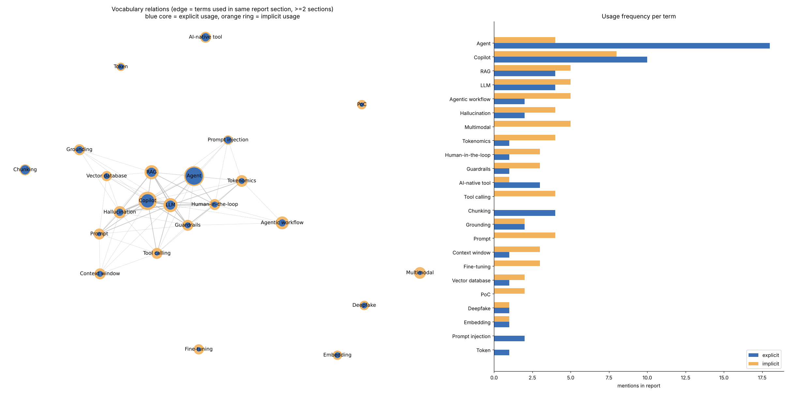

# GenAI Applications Course

My work for the Generative AI Applications course. 

## Structure

- `01-intro-research/` - research on GenAI use cases + vocabulary
  - `genai_applications_report.md` - research report
  - `vocabulary.md` - GenAI terms explained
  - `graph/` - vocabulary relations graph (explicit vs implicit usage in the report)

## Vocabulary graph

